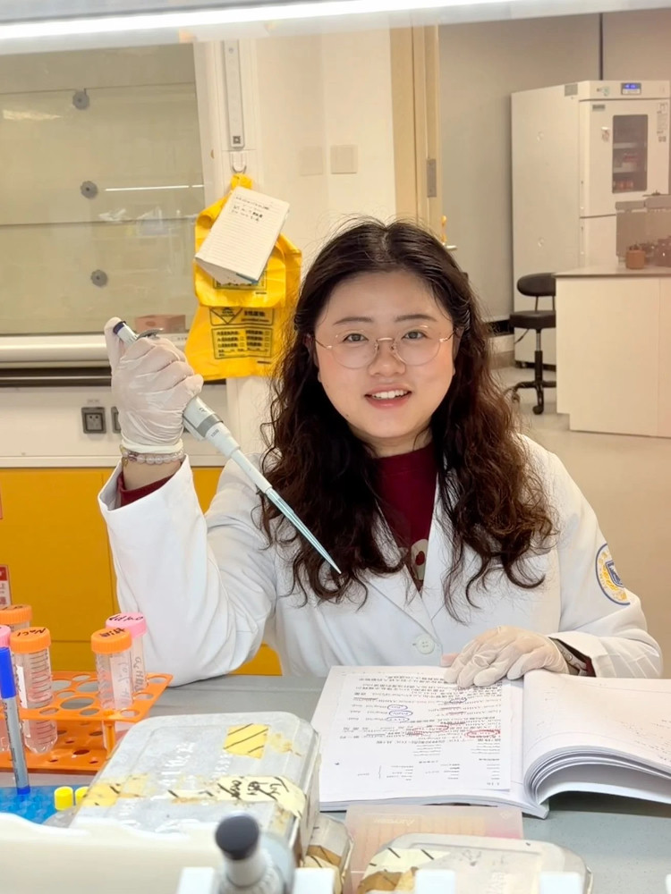

```{=html}
<header class="site-header">
    <div class="nav-wrap">
      <button
        class="brand"
        type="button"
        data-go="home"
        aria-label="Go to Home"
      >
        <span class="brand-mark" aria-hidden="true"></span>
        Qing He
      </button>

      <nav class="nav" aria-label="Primary navigation">
        <button
          class="nav-button is-active"
          data-target="home"
          style="--nav-accent: var(--home)"
        >
          Home
        </button>

        <button
          class="nav-button"
          data-target="experience"
          style="--nav-accent: var(--experience)"
        >
          Experience
        </button>

        <button
          class="nav-button"
          data-target="news"
          style="--nav-accent: var(--news)"
        >
          News
        </button>
      </nav>
    </div>
  </header>

  <main class="viewport">
    <section
      class="panel is-active"
      id="home"
      data-section="home"
      aria-labelledby="home-title"
    >
      <div class="panel-inner">
        <div class="home-hero">
          <div>
            <div class="eyebrow">Academic profile</div>

            <h1 class="hero-title" id="home-title">
              Qing He
            </h1>

            <div class="hero-meta">
              <span>Hangzhou, Zhejiang, China</span>
              <span aria-hidden="true">·</span>
              <a
                class="hero-email"
                href="mailto:heqing990224@163.com"
                data-email-link
                data-email-user="heqing990224"
                data-email-domain="163.com"
                aria-label="Email Qing He"
              >
                <span class="hero-email-label">Email:</span>
                <span data-email-text>heqing990224<span aria-hidden="true">@</span>163.com</span>
              </a>
            </div>

            <div class="profile-links" aria-label="Academic profiles">
              <a class="profile-link" href="https://orcid.org/0009-0009-1138-4365" target="_blank" rel="noopener noreferrer" aria-label="Open Qing He ORCID profile">
                <span class="profile-link-label">ORCID</span>
                <span class="profile-link-value">0009-0009-1138-4365</span>
              </a>

              <a class="profile-link" href="https://www.researchgate.net/profile/Qing-He-54?ev=hdr_xprf&_sg=8JIDaJkC8CQOIIsmKTd4hrXdE8u2gQSacKJTOpzqQP1G1YLmXkYHVivfxUIa-Lt-4Oq8OK9d4lY125gKwbFvw5Dj&_tp=eyJjb250ZXh0Ijp7ImZpcnN0UGFnZSI6ImhvbWUiLCJwYWdlIjoiaG9tZSIsInBvc2l0aW9uIjoiZ2xvYmFsSGVhZGVyIn19" target="_blank" rel="noopener noreferrer" aria-label="Open Qing He ResearchGate profile">
                <span class="profile-link-label">ResearchGate</span>
                <span class="profile-link-value">Qing He</span>
              </a>
            </div>

            <p class="hero-copy">
              Early-career researcher focused on arbovirology,
              mosquito–virus interactions, molecular diagnostics,
              vector surveillance, experimental mosquito infection,
              and viral genomics.
            </p>

            <div
              class="hero-pills"
              aria-label="Research interests"
            >
              <span class="pill">Arbovirology</span>
              <span class="pill">Virus–Vector Interactions</span>
              <span class="pill">Molecular Diagnostics</span>
              <span class="pill">Mosquito Biology</span>
              <span class="pill">Viral Genomics</span>
            </div>
          </div>

          <div class="portrait-wrap">
            <div class="portrait-frame">
              
            </div>
          </div>
        </div>

        <section
          class="section-block"
          aria-labelledby="research-title"
        >
          <div class="section-heading">
            <h2 id="research-title">Research</h2>
            <div class="section-index">Research focus</div>
          </div>

          <div class="grid-3">
            <article class="card">
              <span class="mini-label">Vector surveillance</span>

              <h4>
                Mosquito monitoring &amp; species identification
              </h4>

              <p>
                Longitudinal mosquito surveillance,
                spatiotemporal density analysis, and molecular
                identification of medically important vector species.
              </p>

              <div class="key-tags">
                <span class="key-tag">Aedes</span>
                <span class="key-tag">Culex</span>
                <span class="key-tag">Multiplex PCR</span>
              </div>
            </article>

            <article class="card">
              <span class="mini-label">Molecular diagnostics</span>

              <h4>Rapid arbovirus detection</h4>

              <p>
                PCR- and CRISPR-based workflows for mosquito
                and arbovirus monitoring, including extraction-free
                RT-RAA/CRISPR-Cas12a detection of JEV.
              </p>

              <div class="key-tags">
                <span class="key-tag">JEV</span>
                <span class="key-tag">RT-RAA</span>
                <span class="key-tag">CRISPR-Cas12a</span>
              </div>
            </article>

            <article class="card">
              <span class="mini-label">Virus–vector work</span>

              <h4>
                Experimental mosquito infection &amp; genomics
              </h4>

              <p>
                Hands-on mosquito infection and dissection experience,
                complemented by sequence analysis, phylogenetics,
                and phylogeography using R and Linux.
              </p>

              <div class="key-tags">
                <span class="key-tag">Infection</span>
                <span class="key-tag">Phylogenetics</span>
                <span class="key-tag">R / Linux</span>
              </div>
            </article>
          </div>
        </section>

        <section
          class="section-block"
          aria-labelledby="education-title"
        >
          <div class="section-heading">
            <h2 id="education-title">Education</h2>
            <div class="section-index">Academic training</div>
          </div>

          <div class="education-list">
            <article class="edu-item">
              <div>
                <h3 class="edu-degree">
                  M.S. in Public Health and Preventive Medicine
                </h3>

                <p class="edu-school">
                  Zhejiang Academy of Medical Sciences · Hangzhou, China
                </p>

                <p class="edu-note">
                  GPA: 4.17 / 5
                </p>
              </div>

              <div class="edu-date">
                Sep 2022 — Jun 2025
              </div>
            </article>

            <article class="edu-item">
              <div>
                <h3 class="edu-degree">
                  B.Med. in Preventive Medicine
                </h3>

                <p class="edu-school">
                  Wannan Medical University · Wuhu, China
                </p>

                <p class="edu-note">
                  Minor in Law
                </p>
              </div>

              <div class="edu-date">
                Sep 2017 — Jun 2022
              </div>
            </article>
          </div>
        </section>
      </div>
    </section>

    <section
      class="panel"
      id="experience"
      data-section="experience"
      aria-labelledby="experience-title"
    >
      <div class="panel-inner experience-shell">
        <section
          class="subsection"
          aria-labelledby="experience-title"
        >
          <div class="section-heading">
            <h2 id="experience-title">
              Research Experience
            </h2>

            <div class="section-index">
              Experience
            </div>
          </div>

          <div class="timeline">
            <article class="timeline-item">
              <div class="timeline-date">
                Jul 2025 — Present
              </div>

              <div>
                <h3 class="timeline-role">
                  Research Assistant
                </h3>

                <p class="timeline-org">
                  Sir Run Run Shaw Hospital,
                  School of Medicine, Zhejiang University
                </p>
              </div>
            </article>

            <article class="timeline-item">
              <div class="timeline-date">
                Sep 2022 — Dec 2024
              </div>

              <div>
                <h3 class="timeline-role">
                  Master’s Research Student
                </h3>

                <p class="timeline-org">
                  Provincial Key R&amp;D Project — Mosquito-borne Disease Surveillance ·
                  Zhejiang Academy of Medical Sciences
                </p>

                <p class="timeline-body">
                  Conducted longitudinal mosquito surveillance
                  across 10 surveillance sites in seven cities in
                  Zhejiang Province and analyzed spatiotemporal
                  mosquito-density patterns using R.
                </p>
              </div>
            </article>

            <article class="timeline-item">
              <div class="timeline-date">
                Jul 2023 — May 2025
              </div>

              <div>
                <h3 class="timeline-role">
                  Jointly Supervised Research Student
                </h3>

                <p class="timeline-org">
                  Southern Medical University · Guangzhou, China
                </p>

                <p class="timeline-body">
                  Developed and validated multiplex PCR identification
                  of six medically important mosquito species and
                  an extraction-free RT-RAA/CRISPR-Cas12a assay
                  for JEV detection.
                </p>
              </div>
            </article>
          </div>
        </section>

        <section
          class="subsection"
          aria-labelledby="publications-title"
        >
          <div class="section-heading">
            <h3 id="publications-title">
              Publications
            </h3>

            <div class="section-index">
              Papers &amp; patent
            </div>
          </div>

          <div class="pub-list">
            <article class="pub">
              <div class="pub-year">2026</div>

              <div>
                <p class="pub-title">
                  Guo X, Hu M, Lu Y, Liu X, Chen H, Zhang X,
                  Ge L, Li Z, Wang Y, <strong>He Q</strong>, et al.
                  A CRISPR-Cas12a-based assay for rapid dengue virus
                  monitoring in mosquito and clinical samples
                  facilitating global collaborative surveillance
                  and risk assessment to block dengue spreading.
                </p>

                <p class="pub-meta">
                  <em>Interdisciplinary Medicine</em>.
                  2026;4:e70074.
                </p>

                <div class="badges">
                  <span class="badge article">Article</span>
                </div>
              </div>
            </article>

            <article class="pub">
              <div class="pub-year">2025</div>

              <div>
                <p class="pub-title">
                  <strong>He Q</strong>, Lu Q, Xie N, et al.
                  Real-time dynamic monitoring and multiplex PCR
                  identification of vector mosquitoes in Zhejiang,
                  China.
                </p>

                <p class="pub-meta">
                  <em>PLoS Neglected Tropical Diseases</em>.
                  2025;19(5):e0013129.
                </p>

                <div class="badges">
                  <span class="badge first-author">
                    First author
                  </span>

                  <span class="badge article">
                    Article
                  </span>
                </div>
              </div>
            </article>

            <article class="pub">
              <div class="pub-year">2025</div>

              <div>
                <p class="pub-title">
                  Liu X, Li Z, Guo X, Ge L, Hu M,
                  <strong>He Q</strong>, et al.
                  SMART-RNA-Metavirome: a practical RNA metavirome
                  platform compatible with high-throughput
                  sequencing of both short and long reads.
                </p>

                <p class="pub-meta">
                  <em>Infectious Diseases of Poverty</em>.
                  2025;14(1):101.
                </p>

                <div class="badges">
                  <span class="badge article">
                    Article
                  </span>
                </div>
              </div>
            </article>

            <article class="pub">
              <div class="pub-year">2024</div>

              <div>
                <p class="pub-title">
                  Yu X, <strong>He Q</strong>, Kong Q.
                  Multidisciplinary approaches to combat emerging
                  viruses: diagnostics, therapeutic gene and vaccine
                  delivery, and nanotherapeutics.
                </p>

                <p class="pub-meta">
                  <em>Frontiers in Microbiology</em>.
                  2024;15:1387623.
                </p>

                <div class="badges">
                  <span class="badge review">
                    Review
                  </span>
                </div>
              </div>
            </article>

            <article class="pub">
              <div class="pub-year">
                Under review
              </div>

              <div>
                <p class="pub-title">
                  <strong>He Q</strong>, Li X, Hu Y, et al.
                  An extraction-free RT-RAA/CRISPR-Cas12a assay
                  for rapid detection of Japanese encephalitis
                  virus in mosquito surveillance.
                </p>

                <p class="pub-meta">
                  Under review at
                  <em>Parasites &amp; Vectors</em>.
                </p>

                <div class="badges">
                  <span class="badge first-author">
                    First author
                  </span>

                  <span class="badge article">
                    Article
                  </span>

                  <span class="badge status">
                    Under review
                  </span>
                </div>
              </div>
            </article>
          </div>

          <div class="patent-row">
            <div class="type-label">
              Patent
            </div>

            <h4>
              <strong>He Q</strong>, et al.
              A multiplex PCR detection kit for identifying
              multiple mosquito species.
            </h4>

            <p>
              Chinese Invention Patent Application No.
              <strong>CN202410066806.4</strong> ·
              Published; application pending.
            </p>
          </div>
        </section>

        <section
          class="subsection"
          aria-labelledby="skills-title"
        >
          <div class="section-heading">
            <h3 id="skills-title">
              Technical Skills
            </h3>

            <div class="section-index">
              Methods
            </div>
          </div>

          <div class="skills-grid">
            <article class="skill-card">
              <h4>
                Arbovirus &amp; Mosquito Techniques
              </h4>

              <p>
                Mosquito collection and surveillance;
                mosquito rearing; experimental mosquito infection;
                mosquito dissection.
              </p>

              <div class="skill-chip-row">
                <span class="skill-chip">Collection</span>
                <span class="skill-chip">Rearing</span>
                <span class="skill-chip">Infection</span>
                <span class="skill-chip">Dissection</span>
              </div>
            </article>

            <article class="skill-card">
              <h4>
                Virology &amp; Cell Culture
              </h4>

              <p>
                Cell culture; viral infection;
                virus propagation/enrichment;
                RNA/DNA extraction; qPCR.
              </p>

              <div class="skill-chip-row">
                <span class="skill-chip">Cell culture</span>
                <span class="skill-chip">Virus propagation</span>
                <span class="skill-chip">qPCR</span>
              </div>
            </article>

            <article class="skill-card">
              <h4>
                Molecular Biology &amp; Diagnostics
              </h4>

              <p>
                PCR; RT-RAA; CRISPR-Cas12a;
                primer design; plasmid construction;
                gel electrophoresis.
              </p>

              <div class="skill-chip-row">
                <span class="skill-chip">PCR</span>
                <span class="skill-chip">RT-RAA</span>
                <span class="skill-chip">CRISPR-Cas12a</span>
              </div>
            </article>

            <article class="skill-card">
              <h4>
                Bioinformatics &amp; Data Analysis
              </h4>

              <p>
                R; Linux; MEGA; phylogenetic analysis;
                phylogeographic analysis; SPSS;
                Adobe Illustrator.
              </p>

              <div class="skill-chip-row">
                <span class="skill-chip">R</span>
                <span class="skill-chip">Linux</span>
                <span class="skill-chip">Phylogenetics</span>
                <span class="skill-chip">SPSS</span>
              </div>
            </article>

            <article class="skill-card">
              <h4>
                Animal Experiments
              </h4>

              <p>
                Mouse intraperitoneal injection; oral gavage;
                blood collection; necropsy.
              </p>

              <div class="skill-chip-row">
                <span class="skill-chip">In vivo work</span>
                <span class="skill-chip">Necropsy</span>
                <span class="skill-chip">Sample collection</span>
              </div>
            </article>
          </div>
        </section>
      </div>
    </section>

    <section
      class="panel news-panel"
      id="news"
      data-section="news"
      aria-labelledby="news-title"
    >
      <div class="panel-inner">
        <div class="section-heading">
          <h2 id="news-title">News</h2>
          <div class="section-index">Updates</div>
        </div>

        <div
          class="news-grid"
          id="newsGrid"
          aria-live="polite"
        ></div>

      </div>
    </section>
  </main>

  <footer class="page-footer">
    © <span id="year"></span> Qing He · Academic profile
  </footer>
```
